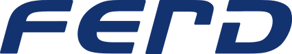

  <a href="https://ferd.no/en/">
    <picture>
      <source media="(prefers-color-scheme: dark)" srcset="assets/ferd-logo-dark.svg">
      
    </picture>
  </a>

<em>Creating enduring value and leaving clear footprints</em>

  Ferd is a family-owned Norwegian investment company, headquartered in Oslo and owned by the 
  fifth and sixth generations of the Andresen family. We are a long-term, active owner — investing 
  in companies, real estate, external funds and social entrepreneurship.

  Our engineering work happens in private repositories&hellip; for now.

  🌐 <a href="https://ferd.no/en/">ferd.no</a>
  &nbsp;·&nbsp;
  💼 <a href="https://www.linkedin.com/company/ferd-as">LinkedIn</a>
  &nbsp;·&nbsp;
  🧭 <a href="https://ferd.no/en/contact/work-at-ferd/">Work at Ferd</a>
  &nbsp;·&nbsp;
  ✉️ <a href="https://ferd.no/en/contact/other-enquiries/">Enquiries</a>

  «Ferd» is Norwegian for <em>journey</em> — a journey without an end.

